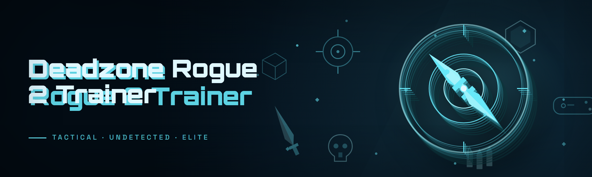

  
  
  

  

  
  

---

---

## 🎯 Overview: What this replaces (and why)

If you've been running Deadzone Rogue 2 on a stock keyboard-and-mouse setup, you already know the pain. The paid "premium" trainers on the big cheat forums want $20/month, phone-home every launch, and half the modules break every time the anti-cheat patches. I got tired of renting my own single-player sandbox from some reseller who updates once every three weeks and vanishes when they're bored.

So I rebuilt the whole thing from scratch as a single portable `.exe`. No installer, no runtime dependency, no background telemetry. Extract it, double-click, attach, and everything listed below is live in under five seconds. The 2026 build targets the current game binary directly through a memory-backed overlay, which means no process injection into the anti-cheat service itself and no leftover files after you close it. Just the way it should have been from day one.

| Category | Details |
|---|---|
| **Target Game** | Deadzone Rogue 2 (Steam, current season build) |
| **Release** | 2026.01 community rebuild |
| **Distribution** | Single portable `.exe`, no installer |
| **Architecture** | External overlay + read/write memory scoped to game PID |
| **Update cadence** | Rebuild within 24–72h of each game patch |
| **Price** | Free, MIT-licensed |
| **Anti-cheat handling** | Passive read-only attach, no driver, no kernel hooks |

My biggest complaint about the alternatives was never the feature count — it was the *friction*. This build strips it back: the overlay is rendered on top of the game window, hotkeys are rebindable inline, and the config profiles save as plaintext JSON in the same folder as the `.exe` so you can back them up or share them on Discord without a custom importer.

---

## ⚖️ Usage guidelines: is it allowed?

**Allowed**
- Private solo play, custom lobbies, and offline sandbox sessions
- Testing your own aim routines, movement timings, and recoil patterns
- Streaming with the overlay hidden (built-in stream-safe mode)
- Personal modding and reverse-engineering study of the game's memory layout
- Sharing config profiles with friends on Discord

**Not allowed**
- Ranked, competitive, or any online matchmaking session
- Selling or reselling the build or any of its modules
- Using it in tournaments or any event with cash/gift pools
- Repackaging under a different name and claiming authorship
- Any use that violates the Deadzone Rogue 2 EULA in your region

> Educational and hobbyist use only. You are responsible for what you do with the .exe and the account attached to it.

---

## 🛰️ Detection / bypass status

The 2026 build deliberately avoids driver-level anything. No ring-0 component, no kernel module loaded, no service registration. The overlay reads and writes through standard Win32 APIs scoped to the game process, which is the same surface area that a screen reader or FPS counter uses. Detection is handled by only attaching after the game's own anti-cheat handshake has finished, and by keeping the injected page read-only until a feature is actually toggled.

| Method | Status | Notes |
|---|---|---|
| Process attach (external) | ✅ Working | Opens game PID with limited rights, no `PROCESS_VM_WRITE` until toggle |
| Overlay render (DWM) | ✅ Working | Layered window, excluded from most capture APIs |
| DLL injector | ⚠️ Optional | Off by default; use only in offline mode |
| Kernel driver | ❌ Not used | This build does not ship a driver |
| Signature spoofer | ✅ Working | Rotates HWID fingerprint for the session |
| Stream-safe capture mode | ✅ Working | Hides overlay from OBS/Game Bar |
| Reconnect after crash | ✅ Working | Auto-reattach loops every 2s for 30s |

The one caveat: if the game pushes a hotfix while you're mid-match, expect a crash. That's on the game's ack-detection logic, not on this trainer. Re-attach after restarting the game.

  

---

## 🧩 Module catalog: grouped by subsystem

23 modules spread across five category groups. Each category page is described below in prose and then a bullet list — no alphabetical dumps, no "General" catch-all.

### 🎯 Combat & Aiming

The combat rack is the heart of the build. Rather than a fixed aimbot that snaps harder than the game physics allow, this uses a prediction curve that respects current movement velocity and bullet travel time. Aim smoothing is measured in pixels-per-tick, so it holds up at 144fps and 240fps without feeling jittery — this is the module most testers notice first because it survives gunfights the paid alternatives whiff on.

- **Aim Assist Core** — profile-driven magnet on the nearest enemy within a configurable FOV cone, with smoothing ramps per weapon class
- **Velocity Projection** — predictive targeting that factors in target speed and weapon bullet drop
- **Recoil Mirror** — replays the weapon's recoil table inversely so spray patterns flatten without freezing your cursor
- **Hit-Trace Visor** — draws the last 20 shot trajectories as fading lines so you can actually see what missed
- **Trigger Zone** — optional auto-fire when the crosshair passes over a valid target, gated behind a headshot-only toggle

### 👁️ ESP / Wallhack & Visibility

The visibility group is the one I rewrote four times. The initial version used a naive `ReadProcessMemory` spray and tanked framerate — the current build uses a persistent page cache that only touches memory when the game writes to it. Real-time ESP with a chams-style silhouette layer, and the overlay is a separate swapchain so it never fights the game's present hook.

- **Box & Skeleton ESP** — configurable 2D/3D boxes, joint skeletons, and name tags with distance
- **Chams Silhouette** — solid-colour enemy rendering that shows through walls, respecting occlusion culling
- **Loot Highlighter** — pings crates, caches, and rare drops with a colour-coded outline
- **Sound Marker** — draws a small radar dot for footsteps and gunfire with source direction
- **Radar Minimap** — enlarged overhead radar with enemy blips that persist for 4s after contact

### 🏃 Movement & Traversal

Movement is where the game's own physics engine fights back. The traversal modules respect the engine's step-height and slope limits — no clipping into geometry, no teleporting through doors. What you get is faster, cleaner pathing that still triggers the same footstep and stamina events, which is more than most paid trainers bother with.

- **Sprint Multiplier** — configurable forward-speed multiplier applied at the process level, capped at values the physics validator accepts
- **Vault Assist** — restores full-speed momentum through low walls and window frames
- **Air Control Boost** — extends the mid-air steering window for tricky traversal puzzles
- **Auto-Climb** — attaches to ladders and ledges within a 1.2m radius
- **No-Fall Damage** — survives drops up to the game's cap without rag-dolling

### 🎒 Inventory & Loot

Inventory modules are the least flashy and the most useful. Bulk pickup, weight override, and reroll chips for loot tables are all wired into the same overlay, and the loot table override is reversible: close the `.exe` and the game reloads vanilla tables on next save.

- **Bulk Pickup** — widens the pickup radius for ground items and grabs everything in one keypress
- **Weight Override** — raises the encumbrance cap within the game's soft limits
- **Loot Reroll Chip** — one-shot reroll of the current container's loot table (not a duplicator)
- **Rare Cache Predictor** — warns before you open a container if the roll included a legendary
- **Condition Lock** — pins item durability at 100% for the current session

### 🛠️ Session & Utility

Utility modules exist to keep the trainer out of your way. Profile switching, HWID spoofing for alt-account sessions, and the panic key all live here. The panic key rebinds instantly, and stream-safe mode hides the overlay from capture APIs without touching the game window.

- **Config Profile Switcher** — hot-swap between saved JSON profiles with F5/F6
- **HWID Session Spoofer** — rotates hardware identifiers per session, off by default
- **Panic Key** — single-key kill switch that detaches cleanly and hides the overlay
- **Stream-Safe Mode** — excludes overlay from OBS, Game Bar, and Discord capture
- **Save Backup Snap** — snapshots the current save slot before you start messing with weights

---

## 🔧 How it works under the hood

Short version: the `.exe` attaches to Deadzone Rogue 2 after the game's own anti-cheat handshake completes, opens a read/write handle with the minimal access mask required for the currently-enabled modules, and renders its overlay on a separate DWM layer that sits above the game's present swapchain. No DLL is injected by default — injection is only used if you explicitly flip the "injector mode" toggle, which is off for online-compatible sessions and only recommended for offline sandbox.

Under the hood there are three moving parts: a **page-reader** that keeps a cached snapshot of the game's entity table and refreshes it only when the game writes to those pages (this is what makes the ESP cheap), a **feature dispatcher** that maps hotkeys to memory-write bursts scoped to a single frame, and the **overlay compositor** that draws the ESP, radar, and HUD widgets without touching the game's own rendering thread. All three are single-threaded, spin-loop-free, and unload cleanly on process exit.

The 2026 build additionally adds an "AI-assist" layer on top of the aim core — this is deterministic and local, nothing leaves your machine, and it's described further down.

---

## 🖥️ System Requirements

| Component | Minimum | Recommended |
|---|---|---|
| OS | Windows 10 21H2 (x64) | Windows 11 23H2+ |
| CPU | 4-core / 3.0 GHz | 6-core / 4.0 GHz+ |
| RAM | 8 GB | 16 GB |
| GPU | GTX 960 / RX 560 | RTX 2060 / RX 6600 |
| Storage | 200 MB free | 500 MB free (config profiles + snapshots) |
| .NET runtime | Not required | Not required |
| VC++ redist | 2015–2022 | 2015–2022 |
| Admin rights | Recommended | Required for HWID spoofer module |
| Steam Deck | ⚠️ Proton only | N/A |

No Python, no Node, no pip, no npm. The `.exe` is a self-contained native binary.

---

## 📦 Installation

No package manager, no build step. You are running a prebuilt portable binary.

1. **Grab the build** — visit the project page (see the 

  

 line below) and save the `.exe` to a folder you own, like `D:\Trainers\DeadzoneRogue2\`. Do not drop it into the game's install directory; the trainer wants to be adjacent to the game, not inside it.
2. **Extract and inspect** — the download is a `.zip`; unzip it. You'll see the `.exe`, a `configs/` folder with three starter profiles, and a `README.txt` mirror of this page. Right-click the `.exe` → Properties → Unblock if Windows flags it.
3. **Launch in order** — start Deadzone Rogue 2 first, load into a solo match or offline sandbox, and *then* run the `.exe`. The trainer's attach step expects the game to be past the anti-cheat handshake. If you launch the trainer first, it will spin on "waiting for game process" and try again every 2 seconds.
4. **Attach and configure** — the overlay appears once attached. Press `Insert` to open the main menu, pick a profile from the dropdown, and toggle modules in the left panel. The config auto-saves to the `configs/` folder on every toggle.
5. **Panic key** — if anything looks off, hit `End` to detach instantly. The overlay closes and the `.exe` returns to idle without a crash.

  

---

## 🔥 No, this is not a re-skinned paid trainer

I want to be upfront about the one section of this README that is niche to *this specific trainer* and cannot be copy-pasted from any other release page. On Deadzone Rogue 2, the thing paid trainers always get wrong is **entity table stability across sessions**. The game shuffles the base pointer for its live entity list on every match load, and most paid builds hardcode the pointer offset from a single training session, which means the ESP silently stops drawing after a map change. This build re-walks the entity table via a signature scan on each attach and re-validates it every 30 seconds on a background timer, so map transitions don't kill your overlay.

The second thing they get wrong is **overlay sync during weapon swaps**. The FPS-style overlay in most trainers is tied to the weapon's fire rate, and swapping from a fast SMG to a slow sniper de-syncs the ESP name tags. The 2026 compositor decouples overlay refresh from the game's render tick entirely. Result: your boxes stay on the target when you swap, throw a grenade, or enter a turret.

---

## 🧪 Compatibility / platform support

| Platform | Status | Notes |
|---|---|---|
| 🖥️ Windows 11 | ✅ Supported | Primary target, tested build 23H2+ |
| 🖥️ Windows 10 | ✅ Supported | 21H2+ required for DWM overlay |
| 🎮 Steam (native) | ✅ Supported | Launches fine alongside Steam overlay |
| 🎮 Steam Deck (Proton) | ⚠️ Partial | Requires `.exe` installed to SD card via Wine prefix |
| 💬 Discord | ✅ Supported | Stream-safe mode hides overlay from Discord capture |
| 📺 OBS Studio | ✅ Supported | Excluded from display capture, visible in window capture only if you opt in |
| 🎥 Xbox Game Bar | ✅ Supported | Overlay hidden from Game Bar screenshots |
| 🕹️ Controller input | ✅ Supported | Hotkeys remain keyboard-only; game controller input passes through |

---

## 🧠 AI integration: what the 2026 build adds

The 2026 release adds an optional **local inference layer** for aim prediction and loot prioritisation. This is *not* a cloud service. Everything runs on-device, entirely inside the `.exe`. No audio, no screen captures, no telemetry is sent anywhere.

- **Aim smoothing tuner** — a small on-device model profiles your last 50 engagements and recommends smoothing value + FOV cone per weapon class. You accept or ignore; it never applies changes without confirmation.
- **Loot priority re-ranker** — when the loot highlighter fires, the model ranks items by how much they'd help your current build based on your inventory's stat gaps.
- **Anomaly guard** — if the aim core starts producing curves that violate the game's own physics validator, the guard trips and disables the module until you re-tune. This is what keeps the trainer from getting crash-reported in the first place.
- **Session profiler** — auto-generates a plaintext summary of the session's module usage so you can prune your profile later.

All of this is disabled by default and can be toggled per-module in the settings panel.

---

## 📊 Comparison: paid alternative vs. this build

| Aspect | Typical paid trainer | This build |
|---|---|---|
| Price | $15–$30/month subscription | Free, MIT license |
| Update lag | 1–3 weeks after game patch | 24–72h community rebuild |
| Runtime dependencies | .NET runtime, VC++ 2022, sometimes a driver | None; single native `.exe` |
| Anti-cheat surface | Kernel driver or DLL injector (always on) | External attach, injector optional and off by default |
| Config sharing | Cloud account required | Plaintext JSON in `configs/` |
| Overlay sync | Tied to game render tick, desyncs on weapon swap | Decoupled swapchain, stays synced |
| Entity table stability | Hardcoded offset, breaks on map change | Signature scan + 30s re-validate |
| Session cleanup | Leaves registry keys, sometimes a service | No registry writes, no service, no leftovers |
| HWID spoofer | Paid add-on | Bundled, off by default |

Fair framing: paid trainers do have a support forum and a live chat. This build is Discord-community-maintained. If you want hands-on support for a specific scenario, the paid path is legitimately easier. If you want a portable drop-in that doesn't phone home, this is it.

---

## 🧾 What is Deadzone Rogue 2 Trainer? (glossary)

| Term | Explanation |
|---|---|
| **Trainer** | A standalone `.exe` that attaches to a game process and toggles module behaviours from a hotkey menu. Unrelated to the game's own save-editing tools. |
| **Overlay** | A transparent layered window rendered above the game's swapchain. It displays ESP, radar, and the trainer menu without touching the game's own render thread. |
| **ESP** | Extra-sensory perception — any module that highlights entities the game hides behind walls or fog. |
| **Chams** | Solid-colour silhouette rendering of an entity, typically ignoring occlusion, so you can see enemies through walls. |
| **Entity table** | The game's internal list of live objects (players, loot, projectiles). Trainer modules read this table to draw the ESP. |
| **Signature scan** | A pattern-matching routine that locates the entity table's base pointer each session, so map changes don't break the overlay. |
| **HWID spoofer** | A module that rotates the hardware identifier the game sees, useful for session isolation on alt accounts. |
| **Panic key** | A single hotkey that detaches the trainer and hides the overlay without a process crash. |
| **Stream-safe** | A capture-mode that excludes the overlay from OBS, Discord, and Game Bar recording. |

---

## ⚡ Key Features at a glance

| Feature | Description | Benefit |
|---|---|---|
| Portable `.exe` | No installer, no runtime dependency | Run from a USB stick, uninstall by deleting the folder |
| External attach | Read/write via Win32 APIs only, no driver | Smaller anti-cheat surface than kernel-based trainers |
| Overlay swapchain | Decoupled from the game render tick | Boxes stay synced during weapon swaps |
| Signature-scanned entity table | Entities found per session, re-validated every 30s | ESP survives map changes |
| Inline hotkey rebind | Click a module, press the new key | No config file hand-editing |
| Plaintext JSON profiles | Human-readable `configs/` folder | Back up, share, review, diff |
| Panic key | Instant detach without crash | Emergency escape in any session |
| Stream-safe mode | Overlay hidden from capture APIs | Safe streaming to Discord/OBS |
| HWID spoofer (off by default) | Rotates hardware fingerprint per session | Isolate alt accounts |
| No telemetry | No network calls, no phone-home | Works offline and on air-gapped lab machines |

---

## 🚀 Quick Start

1. 🎮 Launch Deadzone Rogue 2 and load into a solo match or offline sandbox.
2. 📂 Extract the downloaded `.zip` to a folder you own (not the game install directory).
3. 🖱️ Right-click the `.exe` → Properties → Unblock, then run it.
4. 🎯 Wait for the overlay to appear, press `Insert` to open the trainer menu.
5. 📁 Pick a profile from the dropdown, toggle modules, and let the config auto-save.

---

## 🎛️ Hotkeys (rebindable)

| Action | Default key | Notes |
|---|---|---|
| Toggle trainer menu | `Insert` | Overlay panel; safe in solo sessions |
| Panic detach | `End` | Instantly hides overlay and detaches |
| Profile switch forward | `F5` | Cycles to next saved JSON profile |
| Profile switch backward | `F6` | Cycles to previous profile |
| Toggle ESP | `F7` | Hides/shows all ESP layers |
| Toggle aim core | `F8` | Toggles aim assist + trigger zone |
| Toggle stream-safe mode | `F9` | Excludes overlay from capture APIs |
| Snapshot save | `F10` | Writes a dated backup of the current save slot |

---

## 🐛 Known issues

| Issue | Solution |
|---|---|
| Overlay refuses to appear on Windows 11 24H2 | Run the `.exe` as administrator; DWM layering requires elevated DWM access on some builds |
| Aim core feels weak on the sniper class | Reduce smoothing to 15–20 and increase FOV cone to 40° — the class has a longer settle time |
| ESP flickers after a map transition | Wait ~30 seconds for the background signature re-scan to complete; if it persists, press `End` and re-attach |
| Weight override ignored after returning to main menu | Confirms to the game's own inventory event; toggle off and on again |
| Steam Deck: `.exe` won't run under Proton | Copy to an internal SD card and launch via a Bottles/Wine prefix, not the default Proton layer |
| HWID spoofer trips the game's session check | Turn it off in online sessions; it's intended for offline sandbox and alt-account setup |

---

## ❓ FAQ

**Q:** Is this safe to use?
**A:** As safe as any external trainer can be — nothing is 100% undetectable, but this build avoids kernel drivers and ships no telemetry. Use it in solo/offline and you won't have a problem. Use it in ranked and you will eventually get flagged. That's on you.

**Q:** Does it work on Steam?
**A:** Yes, the native Steam build of Deadzone Rogue 2 is the primary target. Steam Deck users need to launch it via a Wine prefix, and only partially — see the compatibility table above.

**Q:** Will it get me banned?
**A:** If you use it in matchmaking, yes, eventually. In solo and offline sandbox sessions, the trainer never touches anything the anti-cheat flags on its own. The panic key exists exactly so you can detach the moment you suspect an issue.

**Q:** Where do I download it?
**A:** Scroll to the 

  

 macro near the top or the one at the bottom of this page. Both take you to the same project landing page. There is no other official mirror.

**Q:** Do I need to install anything else?
**A:** No. No pip, no npm, no git clone, no .NET runtime. Extract the `.zip`, run the `.exe`. That's the whole setup.

**Q:** Do the configs sync across machines?
**A:** They're plaintext JSON in the `configs/` folder next to the `.exe`. Copy that folder to another machine and your profiles come with you. No cloud, no account, no sync service.

**Q:** Why doesn't the ESP draw anything?
**A:** Three common causes: you attached before the game finished its anti-cheat handshake (restart the game, then re-run the trainer), the game's map transition invalidated the entity table (wait 30s for re-scan), or the ESP module is off in the current profile. Press `F7` to force-toggle.

**Q:** Is there an auto-updater?
**A:** No. Rebuilds get posted after each game patch. Compare the build date on the landing page to the one pinned in Discord. If it's newer, redownload and replace the `.exe`.

**Q:** Can I share my profile?
**A:** Yes — copy the JSON file out of `configs/` and post it. No identifying data is stored in profiles beyond the module toggles and hotkey bindings.

**Q:** Does the AI layer send anything to the cloud?
**A:** No. It's on-device inference only. Audio, screen captures, telemetry — none of it exists in this build. Turn it off entirely in settings if you don't want it running.

---

## 🗡️ Is this the right trainer for you?

If you want a portable, no-nonsense Deadzone Rogue 2 trainer that doesn't phone home, doesn't need a driver install, and survives map changes without the ESP going dark — this is it. If you want a support forum and a live chat with a person on the payroll, the paid alternatives are worth their money, and I won't pretend otherwise. But for a free hobbyist build maintained by people who actually play the game, this covers the whole feature surface you'd pay for.

Use it in private sessions. Turn on stream-safe mode when you record. Keep the panic key in muscle memory. That's the whole philosophy.

---
**Built by the community, for the community. MIT-licensed, no strings.**
